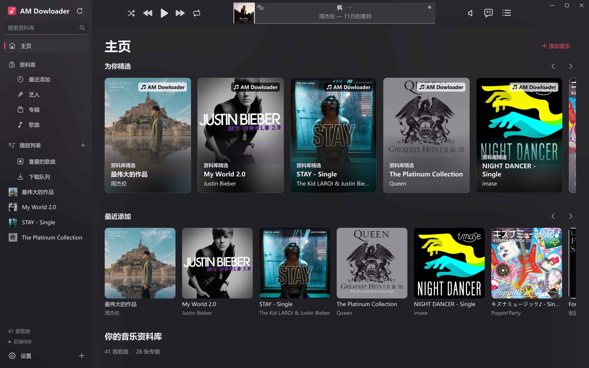
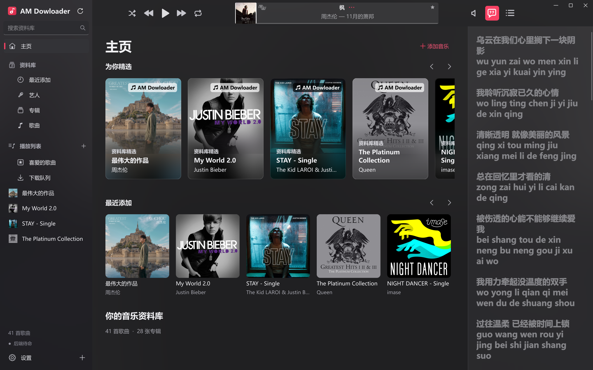

<p align="center">
  
</p>

<h1 align="center">AM Downloader</h1>

<p align="center">音乐下载 · Hi-Fi 本地播放 · 音乐资料库管理</p>
<p align="center">Windows x64 · WASAPI / ASIO · 原生 DSD / DoP · CUE / SACD ISO</p>

<p align="center">
  <a href="https://github.com/Lauk1z/AM-Downloader/releases/latest">下载桌面版</a> ·
  <a href="#界面预览">界面预览</a> ·
  <a href="#播放与解码规格">播放规格</a> ·
  <a href="#从源码构建">源码构建</a> ·
  <a href="#使用与免责声明">使用与免责声明</a>
</p>

AM Downloader 是一款面向 Windows 的音乐下载、本地播放与资料库管理软件。它在 [AppleMusicDecrypt](https://github.com/WorldObservationLog/AppleMusicDecrypt) 的基础上加入桌面界面，提供下载队列、专辑与艺人浏览、歌词、标签与封面编辑、自定义歌单，以及面向兼容 DAC 的独占输出。

也可以只把它作为本地播放器使用：导入文件或整个文件夹，浏览不同版本的专辑，无需登录 Apple 账号。

**当前桌面版：1.5.2。**现有程序内部名称及可执行文件仍为 `AM Dowloader` / `AM Dowloader.exe`，与本仓库的 AM Downloader 指同一软件。项目由独立开发者维护，与 Apple Inc. 无隶属、合作或背书关系。

## 界面预览

### 主界面

通过专辑卡片浏览资料库和最近添加的音乐，顶部播放器与左侧导航保持可用。



### 歌词侧栏

在主界面旁展开歌词，支持时间轴高亮、平滑滚动和点击歌词跳转。



### 音频输出设置

可选择系统共享、WASAPI 独占或 ASIO 输出，并设置设备及 DSD 播放方式。下图展示系统共享模式；原生 DSD / DoP 的可用能力取决于实际设备和驱动。


截图展示软件实际界面；其中的专辑封面与歌词版权归各自权利人所有。

## 主要功能

| 功能 | 说明 |
| --- | --- |
| 音乐下载 | 歌曲、专辑、歌单和艺人链接；多链接添加、任务进度、暂停队列、取消、重试及删除队列记录 |
| 音质选择 | ALAC、AAC、Dolby Digital / Atmos 等后端选项；所选格式不可用时，确认后改用最高可用格式，取消则取消当前任务 |
| 内置后端 | 发布包内集成运行环境，随软件启动服务，无需另行定位外部下载器 |
| 本地音乐 | 多文件导入、文件夹递归扫描和拖入音频；按文件原位置建立索引 |
| 资料库整理 | 按格式、采样率、位深、年份筛选；查找完全重复文件和可能的不同版本，不自动删除 |
| 专辑与艺人 | 专辑详情、艺人双栏浏览；按专辑艺人、版本与目录区分同名专辑 |
| 标签与封面 | 右键专辑批量编辑歌名、艺人、专辑、专辑艺人、年份、碟号、曲序、版本和封面 |
| 自定义歌单 | 新建、重命名、多选拖入、拖动排序，导入 / 导出 M3U 与 M3U8 |
| 歌词 | 本地 LRC 时间轴、当前行高亮、平滑滚动、点击歌词跳转及歌词侧栏 |
| 播放队列 | 独立的「正在播放」侧栏，支持下一首播放、最后播放、排序、移除及重启恢复 |
| 播放方式 | 顺序、循环和每轮不重复的洗牌随机；自动切歌前留出 2 秒间隔，手动切歌立即响应 |
| 输出链路 | 查看源格式、解码或 DSD 传输方式、接口、设备、音量处理与实际协商状态 |
| 托盘与单实例 | 托盘中继续播放和下载；重复启动唤回原窗口；关闭时可选择收起或退出，并记住选择 |
| 界面 | 深色主题、随封面变化的模糊背景、平滑滚动与页面过渡、高 DPI 图标 |

重新启动会恢复上次的队列与最后歌曲，**不会自动开始播放**。当前没有无缝播放或交叉淡化。

## 下载与开始使用

在 [Releases](https://github.com/Lauk1z/AM-Downloader/releases) 下载 **Windows x64** 发布包，ZIP 与 7z 任选一个。将整个 `AM Dowloader` 文件夹解压，运行 `AM Dowloader.exe`。

- 请保留 `_internal`、`backend`、`native` 等随包目录，不能只复制 EXE。
- 无需另外安装 Python、QEMU 或 foobar2000 插件；使用 ASIO 时需自行安装 DAC 厂商的兼容驱动。
- 1.5.2 约为 **341 MB（7z）/ 460 MB（ZIP）**，解压约 **868 MB**，均为十进制单位。用户账号镜像、音乐和播放缓存另占空间。
- 面向 Windows 10 / 11 64 位。后端可使用已启用且可用的 Windows Hypervisor Platform 加速；不可用时采用兼容方式，不会自行开启 Windows 功能。首次初始化需要额外时间和磁盘空间。
- Releases 同时提供 `SHA256SUMS.txt` 与发行文件清单，供核对下载完整性。

### 本地播放

1. 点击「添加音乐 → 导入本地音频」或「导入文件夹」，也可把音频拖入窗口。
2. 在歌曲、专辑、艺人或自定义歌单中选择音乐。
3. 需要独占或 DSD 输出时，在「设置 → 音频输出」选择接口、设备和 DSD 播放方式，再应用设置。
4. 点击播放器的音质标识或「… → 音频输出链路」，查看源格式与输出状态。

### 在线功能

在拥有相应内容权利、且当地法律及服务条款允许的前提下，通过「设置 → 登录 Apple 账号」完成认证，再粘贴链接、选择音质并加入下载队列。账号需具备相应地区的内容访问权限；**订阅不等同于获得任意第三方下载或再传播授权**。

支持登录历史、可选的记住密码和自动登录，并优先复用有效会话。需要双重认证时仍须输入验证码；确认成功后才关闭对应的登录或验证码窗口。

暂停队列会让当前任务继续完成；要停止当前任务请使用取消。删除队列记录保留已经下载的音乐。

## 播放与解码规格

### 音频文件

导入器接受以下 **28 个音频扩展名**，另支持 `.cue` 和 SACD `.iso`。扩展名只是文件入口，实际兼容性由文件编码、封装和内置解码器决定。

| 格式或容器 | 扩展名 |
| --- | --- |
| ALAC / AAC、MP4 音频 | `.m4a`、`.m4b` |
| MPEG 音频 / AAC | `.mp3`、`.mp2`、`.aac` |
| FLAC | `.flac` |
| WAV | `.wav` |
| AIFF / AIFC | `.aif`、`.aiff`、`.aifc` |
| Ogg / Vorbis / Opus / Speex | `.ogg`、`.oga`、`.opus`、`.spx` |
| Monkey’s Audio | `.ape` |
| WavPack | `.wv` |
| True Audio / TAK | `.tta`、`.tak` |
| Windows Media Audio | `.wma` |
| Musepack | `.mpc`、`.mpp`、`.mp+` |
| Dolby Digital / E-AC-3 | `.ac3`、`.eac3`、`.ec3` |
| DSD | `.dsf`、`.dff`、`.dsdiff` |

M4A、Ogg、WavPack 等容器按实际编码识别，不把整个扩展名等同于无损。受 DRM 保护、损坏或使用不受支持编码变体的本地文件，不保证播放。支持 E-AC-3 解码或 Atmos 下载选项，不代表播放器具有 Dolby Atmos 对象渲染、空间音频认证或杜比认证。

### 音频输出

| 模式 | PCM | DSD | 音量与处理 |
| --- | --- | --- | --- |
| 系统共享 | Qt Multimedia / FFmpeg 解码，经 Windows 音频系统输出 | 解码为 PCM | 可调软件音量；最终输出受系统混音器和设备设置影响 |
| WASAPI 独占 | 按源采样率请求设备，协商可用整数位深 | DoP | 旁路软件音量，不主动重采样或混音 |
| ASIO | 按源采样率请求厂商驱动，协商可用整数位深 | 原生 DSD 或 DoP | 旁路软件音量；需兼容的 64 位厂商 ASIO 驱动 |

**PCM：**直通引擎使用 FFmpeg 增量解码为 32 位有符号整数，依据源精度和驱动能力选择 16 / 24 / 32 位整数输出。实际采样率、位深和通道数以设备协商结果为准；浮点源可能发生整数转换，不对所有文件及下游设备作 bit-perfect 保证。共享模式没有直接测量 Windows 混音后的最终规格，不会把源规格当作硬件输出规格。

**原生 DSD：**提供 DSD64 / 128 / 256 / 512 输出路径，DSD512 为 **22.5792 MHz**；原生输出使用 ASIO。能否播放取决于 DAC、USB 接口和厂商驱动的完整链路，不能仅依据解码芯片型号判断。

**DoP：**保留 DSD 载荷，以带标记的 PCM 帧传输。本程序采用每帧每声道 16 个 DSD 数据位的方式，帧速率按 [DoP 开放标准](https://dsd-guide.com/sites/default/files/white-papers/DoP_openStandard_1v1.pdf) 的比例计算：

| DSD 档位 | DSD 采样率 | 所需 DoP PCM 帧速率 |
| --- | --- | --- |
| DSD64 | 2.8224 MHz | 176.4 kHz |
| DSD128 | 5.6448 MHz | 352.8 kHz |
| DSD256 | 11.2896 MHz | 705.6 kHz |
| DSD512 | 22.5792 MHz | 1411.2 kHz |

支持原生 DSD512 不表示支持 DoP DSD512；设备必须同时支持 DoP 协议和对应传输速率。

直通支持 **DSF、未压缩 DFF / DSDIFF**。独立 DST 压缩 DFF 和 WavPack DSD 当前使用共享解码路径。目标规格不被支持、设备断开或被占用时会停止并提示，不静默降级到共享输出或把 DSD 转成 PCM。

> WASAPI / ASIO 直通时软件音量不参与调节。使用前请先在 DAC 或功放设置合适音量。

### CUE 与 SACD ISO

- **CUE 整轨：**解析 INDEX 01 与多 FILE 条目，按需生成 PCM 分轨缓存，可单曲播放、跳转；有效 CUE 引用的整轨不重复列为普通歌曲。
- **SACD ISO：**读取立体声及多声道曲目，通过内置 `sacd_extract` 按需提取 DSF；DST 由上游组件解压。提取后的 DSF 可继续选择共享解码、原生 DSD 或 DoP。
- 首次准备曲目需要额外时间和缓存空间，可在设置中清理播放缓存。普通数据 ISO 不作为音乐导入。
- 标签修正采用本机覆盖信息，不改写原始整轨或镜像；镜像内曲目只允许列表移除，避免误删整张专辑。

### 下载规格与验证范围

下载设置支持 ALAC、AAC、Dolby Digital / Atmos 及相关 AAC 选项；ALAC 采样率上限可选 44.1 / 48 / 96 / 192 kHz，位深上限可选 16 / 24 bit。最终文件取决于实际音源、账号地区和权限，所选格式不可用时由用户确认替代格式。**这些下载上限不限制本地文件的播放规格。**

1.5.2 的单实例、关闭选择与相关播放回归共 50 项通过，并验证正式 EXE 的模块一致性和重启恢复。音频历史验收包括 24 个合成文件样本、DSD64–512 字节与 DoP 封装检查，以及特定 SMSL DAC / 厂商驱动的输出测试；不代表所有设备或每次发布都完成硬件复测。真实商业 SACD / DST 镜像及全部编码变体尚未全面验证。详见 [测试记录](desktop/TEST_REPORT.md)。

## 资料库与文件管理

- **编辑专辑：**右键专辑 →「编辑标签与封面」。普通可写文件先暂存修改，再保留 `.am-tag-backup-*` 原文件备份并写入，不重新编码音频。其他格式使用本机元数据覆盖。
- **管理歌单：**侧栏「播放列表」旁的加号可新建或导入。M3U 保存文件引用，不复制音乐；网络流条目当前会跳过。CUE / ISO 分轨使用 `#EXT-AM-TRACK` 扩展，其他播放器未必识别。
- **删除音乐：**「从列表中删除」保留原文件；「删除本地文件」使用 Windows 回收站，失败后不改为永久删除。
- **关闭方式：**默认询问「最小化到托盘」或「关闭程序」，可勾选「记住我的选择」，也可在设置中修改。托盘右键「退出」始终执行退出流程。

## 数据与隐私

用户数据沿用 `%LOCALAPPDATA%\MusicDesk`：偏好、收藏、歌单、队列、导入记录、登录历史与缓存；后端配置和私有账号镜像位于其 `backend` 子目录。音乐保存在用户选择的位置，修改资料库路径不会自动搬动已有文件。

勾选「记住密码」后，成功登录的密码用当前 Windows 用户的 DPAPI 加密保存；账号历史不加密，验证码不持久保存。有效登录会话位于用户私有服务镜像。在线功能会与相关服务通信，本地加密不代表账号在所有环境下都绝对安全。

本仓库和发行包不包含个人账号、私有账号镜像或音乐。分享日志、截图或配置前，请自行检查并去除账号、令牌、验证码与私人路径；不要上传用户数据目录。

## 从源码构建

桌面版源码位于 [`desktop/`](desktop/)。需要 **Windows x64、Python 3.12、Visual Studio C++ x64 构建工具及 Windows SDK**；生成 7z 包另需 7-Zip。首次构建需联网获取固定版本的第三方运行包。

```powershell
git clone https://github.com/Lauk1z/AM-Downloader.git
cd AM-Downloader\desktop
py -3.12 -m venv .build-venv
.\.build-venv\Scripts\python.exe -m pip install -r requirements-build.txt
.\.build-venv\Scripts\python.exe build.py
.\.build-venv\Scripts\python.exe package_release.py --7z
```

输出位于 `desktop\dist\AM Dowloader`，归档、文件清单及校验和位于 `desktop\release`。只生成 ZIP 时省略 `--7z`。

后端以 `build_backend.py` 中固定的提交、运行包和 SHA-256 为准，集成修改由 `backend_patches.py` 应用。原上游 Actions 附件已不可获取，因此本仓库在 1.5.2 Release 镜像保存原始 `AppleMusicDecrypt-v2-runtime.zip`，构建脚本使用该固定地址并保留原 SHA-256 校验。普通使用只需下载桌面 ZIP 或 7z，**不必另下这个构建运行包**。发布包内同时保留对应后端源码、依赖清单与组件来源。

### Fork 与目录说明

本仓库 Fork 自 [WorldObservationLog/AppleMusicDecrypt](https://github.com/WorldObservationLog/AppleMusicDecrypt)，保留其提交历史及 `v3` 命令行 / TUI 源码。**桌面版 1.5.2 仍固定集成 v2 后端提交 `d1a9a10079a72a454ce013589a5a47d5c17c8aee`，尚未迁移到 v3。**

| 路径 | 用途 |
| --- | --- |
| `desktop/` | 本项目 Windows 桌面端、原生音频引擎、集成补丁、测试与构建脚本 |
| `src/`、`main.py`、`qemu/` | Fork 时保留的上游 v3 源码 |
| 根目录 `requirements.txt`、`pyproject.toml`、`uv.lock` | 上游 v3 依赖；不是桌面版构建依赖 |
| [UPSTREAM_README.md](UPSTREAM_README.md) | Fork 时保留的上游说明 |
| [desktop/CHANGELOG.md](desktop/CHANGELOG.md) | 桌面版历史更新记录 |

上游 `.github/workflows/win-build.yml` 仍属于 v3 工程，生成的是上游命令行包；本桌面版请使用上述 `desktop` 构建步骤或下载本仓库 Releases 附件。

## Contributors

| 贡献者 | 参与内容 |
| --- | --- |
| [Lauk1z](https://github.com/Lauk1z) | 项目维护、需求与界面设计、功能验收和版本发布 |
| Codex（OpenAI，AI 编程助手） | 在维护者指导下辅助实现功能、排查问题、编写测试与整理文档 |

## 开源许可与致谢

项目代码按 **GNU AGPL-3.0-or-later** 提供，详见 [LICENSE.txt](LICENSE.txt)。再分发和修改时请履行适用许可证的源码提供与声明保留义务；软件许可证不授予音乐、封面、歌词或商标的使用权。

感谢 AppleMusicDecrypt、Qt / PySide6、FFmpeg、QEMU、Mutagen、GPAC、Bento4、sacd_extract 等项目。第三方组件各自适用其许可证，来源和文本见 [THIRD_PARTY_NOTICES.md](desktop/THIRD_PARTY_NOTICES.md) 与 [licenses](desktop/licenses)。ASIO SDK 使用其 GPLv3 许可选项，厂商 ASIO 驱动不随包分发。

Apple、Apple Music、ASIO、Dolby 等名称与商标归各自权利人所有，提及仅用于说明功能、来源与兼容性，不表示获得认证或背书。

## 使用与免责声明

1. **内容与授权。**请仅处理你拥有相应权利或已获合法授权的内容，遵守所在地法律与服务条款。不得用于侵犯著作权、盗用账号、未经授权规避技术保护措施，或未经授权传播、销售音乐。
2. **第三方服务。**在线功能依赖第三方接口、账号状态与上游组件，可能因地区、订阅、风控或接口变化而失效。订阅不代表服务方允许本软件的全部行为；使用前请阅读账号所在地区的现行条款，例如 [Apple 中国大陆媒体服务条款](https://www.apple.com/legal/internet-services/itunes/cn/terms.html) 中关于访问方式和安全技术的限制。
3. **按现状提供。**在适用法律允许的范围内，本软件不对持续可用性、特定用途适用性、所有音源和设备兼容性或无错误运行作出保证。担保排除与责任限制以适用法律及项目许可证为准，不排除依法不得排除的责任。
4. **数据与设备。**修改标签、删除文件或整理资料库前请备份重要数据；独占、原生 DSD 和 DoP 需要兼容硬件与正确驱动，并应确认硬件音量。
5. **声明边界。**本说明不构成法律意见，也不授予第三方内容或服务权限。「学习研究」「个人使用」或自行设定的删除期限不能替代合法授权，也不能豁免违法或违约责任。

上述内容使用要求不替代或缩减开源许可证对软件代码授予的权利。
