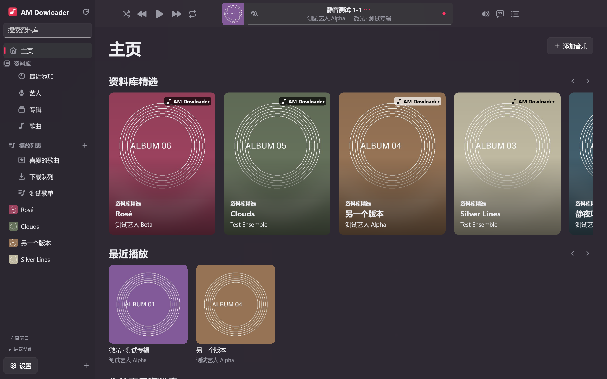
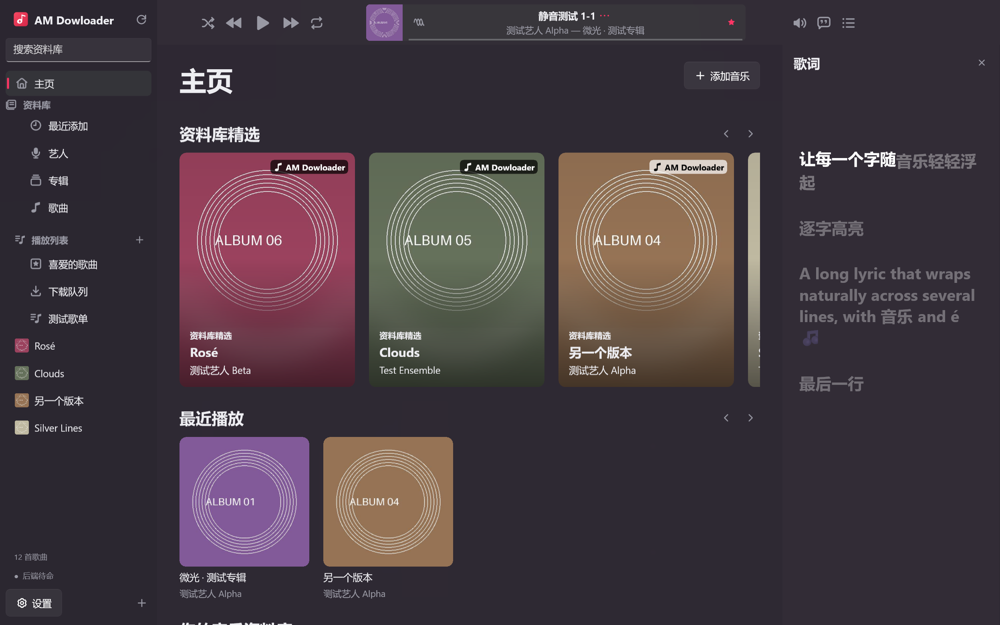
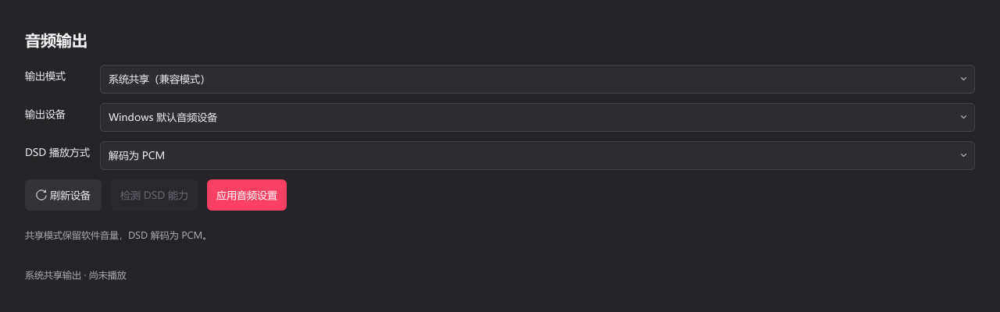

<p align="center">
  
</p>

<h1 align="center">AM Downloader</h1>

<p align="center">音乐下载 · Hi-Fi 本地播放 · 音乐资料库管理</p>
<p align="center">原生 WinUI 3 · Windows x64 · WASAPI / ASIO · 原生 DSD / DoP · CUE / SACD ISO</p>

<p align="center">
  <a href="https://github.com/Lauk1z/AM-Downloader/releases/tag/v2.0.0-preview.3">下载 WinUI 3 预览版</a> ·
  <a href="https://github.com/Lauk1z/AM-Downloader/releases/tag/v1.5.2">1.5.2 稳定版</a> ·
  <a href="#界面预览">界面预览</a> ·
  <a href="#播放与解码规格">播放规格</a> ·
  <a href="#从源码构建">源码构建</a> ·
  <a href="#使用与免责声明">使用与免责声明</a>
</p>

AM Downloader 是一款面向 Windows 的音乐下载、本地播放与资料库管理软件。它在 [AppleMusicDecrypt](https://github.com/WorldObservationLog/AppleMusicDecrypt) 的基础上加入桌面界面，提供下载队列、专辑与艺人浏览、歌词、标签与封面编辑、自定义歌单，以及面向兼容 DAC 的独占输出。

**2.0 原生重构：**窗口、页面、动画、播放控制、队列、登录、设置、托盘与单实例逻辑迁移到 **C# + WinUI 3 + Windows Composition**。新程序不加载 Qt、PySide6 或 Qt Multimedia；继续使用 C++ 音频引擎、AppleMusicDecrypt 后端和独立的无 Qt Python 资料库工具进程，保留原有布局和操作逻辑。详见 [本次大升级说明](docs/releases/v2.0.0-preview.1.md)。

也可以只把它作为本地播放器使用：导入文件或整个文件夹，浏览不同版本的专辑，无需登录 Apple 账号。

**当前 WinUI 预览版：2.0.0-preview.3；稳定版：1.5.2。**新版运行入口是 `AM Downloader WinUI.exe`，界面名称沿用 `AM Dowloader`。本次修复歌曲列表高亮叠加，加入歌词上下渐隐、逐字高亮与浮起，并提供安装版 EXE，详见 [更新说明](docs/releases/v2.0.0-preview.3.md)。真实 Apple 账号、DAC 独占播放和部分编码样本仍需实机验收；不把旧 Qt 版的硬件测试当作新版测试结果。项目由独立开发者维护，与 Apple Inc. 无隶属、合作或背书关系。

## 界面预览

### 主界面

通过专辑卡片浏览资料库和最近添加的音乐，顶部播放器与左侧导航保持可用。



### 歌词侧栏

在主界面旁展开歌词，支持上下渐隐、逐字高亮与轻微浮起、平滑滚动和点击跳转。有增强 LRC 时间标记时按标记同步，普通 LRC 的句内进度按时间估算；下图为原生文字的静态捕获，不包含 Composition 渐隐遮罩。



### 音频输出设置

可选择系统共享、WASAPI 独占或 ASIO 输出，并设置设备及 DSD 播放方式。下图保留 **1.5.2 Qt 版**的输出设置供功能参考，不能代表新版控件外观；WinUI 版保留这些设置，新增驱动选择与失败回滚修复。原生 DSD / DoP 的可用能力取决于实际设备和驱动。



前两张为 WinUI 3 正式发布 EXE 在独立测试资料库中的实际渲染，使用生成的封面和示例歌词；第三张为旧版实际界面。其中的第三方专辑封面与歌词版权归各自权利人所有。

## 主要功能

| 功能 | 说明 |
| --- | --- |
| 音乐下载 | 歌曲、专辑、歌单和艺人链接；多链接添加、任务进度、暂停队列、取消、重试及删除队列记录 |
| 音质选择 | ALAC、AAC、Dolby Digital / Atmos 等后端选项；所选格式不可用时，确认后改用最高可用格式，取消则取消当前任务 |
| 内置后端 | 发布包内集成运行环境，随软件启动服务，无需另行定位外部下载器 |
| 本地音乐 | 多文件导入、文件夹递归扫描和拖入音频；按文件原位置建立索引 |
| 资料库整理 | 按格式、采样率、位深、年份筛选；查找完全重复文件和可能的不同版本，不自动删除 |
| 专辑与艺人 | 专辑详情、艺人双栏浏览；按专辑艺人、版本与目录区分同名专辑 |
| 标签与封面 | 右键专辑批量编辑歌名、艺人、专辑、专辑艺人、年份、碟号、曲序、版本和封面 |
| 自定义歌单 | 新建、重命名、多选拖入、拖动排序，导入 / 导出 M3U 与 M3U8 |
| 歌词 | 本地／增强 LRC、上下渐隐、逐字高亮与浮起、平滑滚动和点击跳转；普通 LRC 的逐字进度按句内时间估算 |
| 播放队列 | 独立的「正在播放」侧栏，支持下一首播放、最后播放、排序、移除及重启恢复 |
| 播放方式 | 顺序、循环和每轮不重复的洗牌随机；自动切歌前留出 2 秒间隔，手动切歌立即响应 |
| 输出链路 | 查看源格式、解码或 DSD 传输方式、接口、设备、音量处理与实际协商状态 |
| 托盘与单实例 | 托盘中继续播放和下载；重复启动唤回原窗口；关闭时可选择收起或退出，并记住选择 |
| 界面 | 深色主题、随封面变化的模糊背景、平滑滚动与页面过渡、高 DPI 图标 |

重新启动会恢复上次的队列与最后歌曲，**不会自动开始播放**。当前没有无缝播放或交叉淡化。

## 下载与开始使用

在 [2.0.0-preview.3 Release](https://github.com/Lauk1z/AM-Downloader/releases/tag/v2.0.0-preview.3) 下载 `AM-Downloader-2.0.0-preview.3-WinUI3-Windows-x64-Setup.exe` 安装版，或选择同版本便携 ZIP，完整解压后运行 `AM Downloader WinUI.exe`。源码归档不能直接运行。升级前请在托盘菜单选择「退出」。

- Windows 10 2004（19041）及更新版本，x64。包内带 .NET 和 Windows App SDK 运行时，无需另装 Python、.NET SDK、QEMU 或 foobar2000 插件；ASIO 需自行安装 DAC 对应的 64 位驱动。
- 安装版约 **374 MiB**，默认安装到当前用户的 `%LOCALAPPDATA%\Programs\AM Downloader`，支持选择目录、开始菜单／可选桌面快捷方式及卸载。卸载保留个人资料库和音乐，安装器尚未进行代码签名。
- 便携版保留整个解压目录及其子目录，不能只复制 EXE。ZIP **463,894,837 字节（约 442 MiB）**，解压约 **842 MiB**；账号镜像、音乐和播放缓存另占空间。
- 后端可使用已启用且可用的 Windows Hypervisor Platform 加速；不可用时采用兼容方式，不自行开启 Windows 功能。首次初始化需要额外时间与磁盘空间。
- 发布页提供 `SHA256SUMS.txt`；包内 `manifest.sha256.json` 可核对全部文件。
- 1.5.2 稳定版仍可单独下载，入口为 `AM Dowloader.exe`，其 `_internal` 等目录不能与 WinUI 包混用。

### 从 1.5.2 迁移

1. 在托盘菜单正常退出旧版，再打开 WinUI 版，避免两个版本同时写同一份资料库。
2. 新版默认继续使用 `%LOCALAPPDATA%\MusicDesk`，兼容原有资料库路径、收藏、歌单、队列、最后歌曲和同一 Windows 用户的 DPAPI 账号信息；首次写入前备份原偏好文件。升级前仍建议自行备份重要数据。
3. 先试用独立资料库时，可运行 `& '.\AM Downloader WinUI.exe' --data-dir 'D:\AM-WinUI-Test'`。
4. ZIP 不会自动卸载或覆盖旧版；回退前也应先正常退出新版。

### 本地播放

1. 点击「添加音乐 → 导入本地音频」或「导入文件夹」，也可把音频拖入窗口。
2. 在歌曲、专辑、艺人或自定义歌单中选择音乐。
3. 需要独占或 DSD 输出时，在「设置 → 音频输出」选择接口、设备和 DSD 播放方式，再应用设置。
4. 点击播放器的音质标识或「… → 音频输出链路」，查看源格式与输出状态。

### 在线功能

在拥有相应内容权利、且当地法律及服务条款允许的前提下，通过「设置 → 登录 Apple 账号」完成认证，再粘贴链接、选择音质并加入下载队列。账号需具备相应地区的内容访问权限；**订阅不等同于获得任意第三方下载或再传播授权**。

支持登录历史、可选的记住密码和自动登录，并优先复用有效会话。需要双重认证时仍须输入验证码；确认成功后才关闭对应的登录或验证码窗口。

暂停队列会让当前任务继续完成；要停止当前任务请使用取消。删除队列记录保留已经下载的音乐。

## 播放与解码规格

### 音频文件

导入器接受以下 **28 个音频扩展名**，另支持 `.cue` 和 SACD `.iso`。扩展名只是文件入口，实际兼容性由文件编码、封装和内置解码器决定。

| 格式或容器 | 扩展名 |
| --- | --- |
| ALAC / AAC、MP4 音频 | `.m4a`、`.m4b` |
| MPEG 音频 / AAC | `.mp3`、`.mp2`、`.aac` |
| FLAC | `.flac` |
| WAV | `.wav` |
| AIFF / AIFC | `.aif`、`.aiff`、`.aifc` |
| Ogg / Vorbis / Opus / Speex | `.ogg`、`.oga`、`.opus`、`.spx` |
| Monkey’s Audio | `.ape` |
| WavPack | `.wv` |
| True Audio / TAK | `.tta`、`.tak` |
| Windows Media Audio | `.wma` |
| Musepack | `.mpc`、`.mpp`、`.mp+` |
| Dolby Digital / E-AC-3 | `.ac3`、`.eac3`、`.ec3` |
| DSD | `.dsf`、`.dff`、`.dsdiff` |

M4A、Ogg、WavPack 等容器按实际编码识别，不把整个扩展名等同于无损。受 DRM 保护、损坏或使用不受支持编码变体的本地文件，不保证播放。支持 E-AC-3 解码或 Atmos 下载选项，不代表播放器具有 Dolby Atmos 对象渲染、空间音频认证或杜比认证。

### 音频输出

| 模式 | PCM | DSD | 音量与处理 |
| --- | --- | --- | --- |
| 系统共享 | FFmpeg 解码为 PCM，由原生音频主机经 Windows 共享音频系统输出 | 解码为 PCM | 可调软件音量；最终输出受系统混音器和设备设置影响 |
| WASAPI 独占 | 按源采样率请求设备，协商可用整数位深 | DoP | 旁路软件音量，不主动重采样或混音 |
| ASIO | 按源采样率请求厂商驱动，协商可用整数位深 | 原生 DSD 或 DoP | 旁路软件音量；需兼容的 64 位厂商 ASIO 驱动 |

**PCM：**直通引擎使用 FFmpeg 增量解码为 32 位有符号整数，依据源精度和驱动能力选择 16 / 24 / 32 位整数输出。实际采样率、位深和通道数以设备协商结果为准；浮点源可能发生整数转换，不对所有文件及下游设备作 bit-perfect 保证。共享模式没有直接测量 Windows 混音后的最终规格，不会把源规格当作硬件输出规格。

**原生 DSD：**提供 DSD64 / 128 / 256 / 512 输出路径，DSD512 为 **22.5792 MHz**；原生输出使用 ASIO。能否播放取决于 DAC、USB 接口和厂商驱动的完整链路，不能仅依据解码芯片型号判断。

**DoP：**保留 DSD 载荷，以带标记的 PCM 帧传输。本程序采用每帧每声道 16 个 DSD 数据位的方式，帧速率按 [DoP 开放标准](https://dsd-guide.com/sites/default/files/white-papers/DoP_openStandard_1v1.pdf) 的比例计算：

| DSD 档位 | DSD 采样率 | 所需 DoP PCM 帧速率 |
| --- | --- | --- |
| DSD64 | 2.8224 MHz | 176.4 kHz |
| DSD128 | 5.6448 MHz | 352.8 kHz |
| DSD256 | 11.2896 MHz | 705.6 kHz |
| DSD512 | 22.5792 MHz | 1411.2 kHz |

支持原生 DSD512 不表示支持 DoP DSD512；设备必须同时支持 DoP 协议和对应传输速率。

直通支持 **DSF、未压缩 DFF / DSDIFF**。独立 DST 压缩 DFF 和 WavPack DSD 当前使用共享解码路径。目标规格不被支持、设备断开或被占用时会停止并提示，不静默降级到共享输出或把 DSD 转成 PCM。

> WASAPI / ASIO 直通时软件音量不参与调节。使用前请先在 DAC 或功放设置合适音量。

### CUE 与 SACD ISO

- **CUE 整轨：**解析 INDEX 01 与多 FILE 条目，按需生成 PCM 分轨缓存，可单曲播放、跳转；有效 CUE 引用的整轨不重复列为普通歌曲。
- **SACD ISO：**读取立体声及多声道曲目，通过内置 `sacd_extract` 按需提取 DSF；DST 由上游组件解压。提取后的 DSF 可继续选择共享解码、原生 DSD 或 DoP。
- 首次准备曲目需要额外时间和缓存空间，可在设置中清理播放缓存。普通数据 ISO 不作为音乐导入。
- 标签修正采用本机覆盖信息，不改写原始整轨或镜像；镜像内曲目只允许列表移除，避免误删整张专辑。

### 下载规格与验证范围

下载设置支持 ALAC、AAC、Dolby Digital / Atmos 及相关 AAC 选项；ALAC 采样率上限可选 44.1 / 48 / 96 / 192 kHz，位深上限可选 16 / 24 bit。最终文件取决于实际音源、账号地区和权限，所选格式不可用时由用户确认替代格式。**这些下载上限不限制本地文件的播放规格。**

WinUI preview.1 已通过 **126 项核心断言、26 项引擎测试、4 项音频服务回归，以及正式发布 EXE 的 25 项界面与生命周期检查**；18 种生成音频、DSD64–512 / DoP 字节与定位检查通过。preview.2 补充 28 组图标的三种尺寸和四种状态检查。preview.3 已通过 **132 项核心断言、正式包 28 项原生集成检查、4,414 个文件的校验与包外运行，以及安装／覆盖升级／卸载检查**。歌词渐隐的合成连接已检查，动态观感和帧率尚未人工验收。此前 USB DAC ASIO 驱动连续三次查询报告 DSD64 / 128 / 256 / 512，这只证明能力查询，不证明相应档位已实际播放。

真实 Apple 登录与下载、实际 DAC 的 WASAPI / ASIO / DoP / 原生 DSD 播放、真实 APE / TAK / Musepack / DST 样本及高刷新率动画体验，尚需新版实机验收。详见 [WinUI 验证与待验收范围](desktop/winui/MIGRATION.md)。[旧版测试记录](desktop/TEST_REPORT.md) 仅作为历史参考。

## 资料库与文件管理

- **编辑专辑：**右键专辑 →「编辑标签与封面」。普通可写文件先暂存修改，再保留 `.am-tag-backup-*` 原文件备份并写入，不重新编码音频。其他格式使用本机元数据覆盖。
- **管理歌单：**侧栏「播放列表」旁的加号可新建或导入。M3U 保存文件引用，不复制音乐；网络流条目当前会跳过。CUE / ISO 分轨使用 `#EXT-AM-TRACK` 扩展，其他播放器未必识别。
- **删除音乐：**「从列表中删除」保留原文件；「删除本地文件」使用 Windows 回收站，失败后不改为永久删除。
- **关闭方式：**默认询问「最小化到托盘」或「关闭程序」，可勾选「记住我的选择」，也可在设置中修改。托盘右键「退出」始终执行退出流程。

## 数据与隐私

用户数据沿用 `%LOCALAPPDATA%\MusicDesk`：偏好、收藏、歌单、队列、导入记录、登录历史与缓存；后端配置和私有账号镜像位于其 `backend` 子目录。音乐保存在用户选择的位置，修改资料库路径不会自动搬动已有文件。

勾选「记住密码」后，成功登录的密码用当前 Windows 用户的 DPAPI 加密保存；账号历史不加密，验证码不持久保存。有效登录会话位于用户私有服务镜像。在线功能会与相关服务通信，本地加密不代表账号在所有环境下都绝对安全。

本仓库和发行包不包含个人账号、私有账号镜像或音乐。分享日志、截图或配置前，请自行检查并去除账号、令牌、验证码与私人路径；不要上传用户数据目录。

## 从源码构建

WinUI 源码位于 [`desktop/winui/`](desktop/winui/)。需要 **Windows x64、.NET 10 SDK、Python 3.12、Visual Studio C++ x64 Build Tools 和 Windows SDK**。首次构建需联网获取固定版本的 NuGet 包和后端运行包。

```powershell
git clone https://github.com/Lauk1z/AM-Downloader.git
cd AM-Downloader\desktop
py -3.12 winui/build_native.py
dotnet run --project winui/AMDownloader.Tests/AMDownloader.Tests.csproj
dotnet run --project winui/tests/AudioService.Tests -- qa/audio-service
dotnet build winui/AMDownloader.WinUI/AMDownloader.WinUI.csproj
py -3.12 winui/build_package.py --output winui/artifacts/my-winui-build
```

输出位于 `desktop\winui\artifacts\my-winui-build` 及同名 ZIP，带逐文件清单和归档校验和。新建构建目录，脚本不会覆盖已有包。独立解压验收命令及测试依赖见 [WinUI 构建说明](desktop/winui/README.md)。原 Qt 工程保留在 `desktop/`，其 `build.py` / `package_release.py` 构建的是旧版。

后端以 `build_backend.py` 中固定的提交、运行包和 SHA-256 为准，集成修改由 `backend_patches.py` 应用。原上游 Actions 附件已不可获取，因此本仓库在 1.5.2 Release 镜像保存原始 `AppleMusicDecrypt-v2-runtime.zip`，构建脚本使用该固定地址并保留原 SHA-256 校验。普通使用只需下载桌面 ZIP 或 7z，**不必另下这个构建运行包**。发布包内同时保留对应后端源码、依赖清单与组件来源。

### Fork 与目录说明

本仓库 Fork 自 [WorldObservationLog/AppleMusicDecrypt](https://github.com/WorldObservationLog/AppleMusicDecrypt)，保留其提交历史及 `v3` 命令行 / TUI 源码。**WinUI 2.0 预览版和 Qt 1.5.2 都固定集成 v2 后端提交 `d1a9a10079a72a454ce013589a5a47d5c17c8aee`，尚未迁移到 v3 下载后端。**WinUI 重构改变应用层，不代表升级了下载后端版本。

| 路径 | 用途 |
| --- | --- |
| `desktop/winui/` | 新的 C# / WinUI 3 应用、无 Qt 资料库进程、测试与发布构建脚本 |
| `desktop/native/` | WinUI 和旧版共用的 C++ WASAPI / ASIO / DSD 音频主机及 SACD 组件 |
| `desktop/` 其他文件 | 保留的 Qt 桌面端、后端集成补丁、媒体工具、测试与构建脚本 |
| `src/`、`main.py`、`qemu/` | Fork 时保留的上游 v3 源码 |
| 根目录 `requirements.txt`、`pyproject.toml`、`uv.lock` | 上游 v3 依赖；不是桌面版构建依赖 |
| [UPSTREAM_README.md](UPSTREAM_README.md) | Fork 时保留的上游说明 |
| [desktop/CHANGELOG.md](desktop/CHANGELOG.md) | 桌面版历史更新记录 |

上游 `.github/workflows/win-build.yml` 仍属于 v3 工程，生成的是上游命令行包；本桌面版请使用上述 `desktop` 构建步骤或下载本仓库 Releases 附件。

## 开源许可与致谢

项目代码按 **GNU AGPL-3.0-or-later** 提供，详见 [LICENSE.txt](LICENSE.txt)。再分发和修改时请履行适用许可证的源码提供与声明保留义务；软件许可证不授予音乐、封面、歌词或商标的使用权。

感谢 AppleMusicDecrypt、WinUI / Windows App SDK、.NET、FFmpeg、QEMU、Mutagen、GPAC、Bento4、sacd_extract，以及旧版使用的 Qt / PySide6 等项目。WinUI 发布包不使用 Qt 运行库。第三方组件各自适用其许可证，来源和文本见 [WinUI 第三方声明](desktop/winui/THIRD_PARTY_NOTICES.md)、[旧版声明](desktop/THIRD_PARTY_NOTICES.md) 与 [licenses](desktop/licenses)。ASIO SDK 使用其 GPLv3 许可选项，厂商 ASIO 驱动不随包分发。

Apple、Apple Music、ASIO、Dolby 等名称与商标归各自权利人所有，提及仅用于说明功能、来源与兼容性，不表示获得认证或背书。

## 使用与免责声明

1. **内容与授权。**请仅处理你拥有相应权利或已获合法授权的内容，遵守所在地法律与服务条款。不得用于侵犯著作权、盗用账号、未经授权规避技术保护措施，或未经授权传播、销售音乐。
2. **第三方服务。**在线功能依赖第三方接口、账号状态与上游组件，可能因地区、订阅、风控或接口变化而失效。订阅不代表服务方允许本软件的全部行为；使用前请阅读账号所在地区的现行条款，例如 [Apple 中国大陆媒体服务条款](https://www.apple.com/legal/internet-services/itunes/cn/terms.html) 中关于访问方式和安全技术的限制。
3. **按现状提供。**在适用法律允许的范围内，本软件不对持续可用性、特定用途适用性、所有音源和设备兼容性或无错误运行作出保证。担保排除与责任限制以适用法律及项目许可证为准，不排除依法不得排除的责任。
4. **数据与设备。**修改标签、删除文件或整理资料库前请备份重要数据；独占、原生 DSD 和 DoP 需要兼容硬件与正确驱动，并应确认硬件音量。
5. **声明边界。**本说明不构成法律意见，也不授予第三方内容或服务权限。「学习研究」「个人使用」或自行设定的删除期限不能替代合法授权，也不能豁免违法或违约责任。

上述内容使用要求不替代或缩减开源许可证对软件代码授予的权利。
