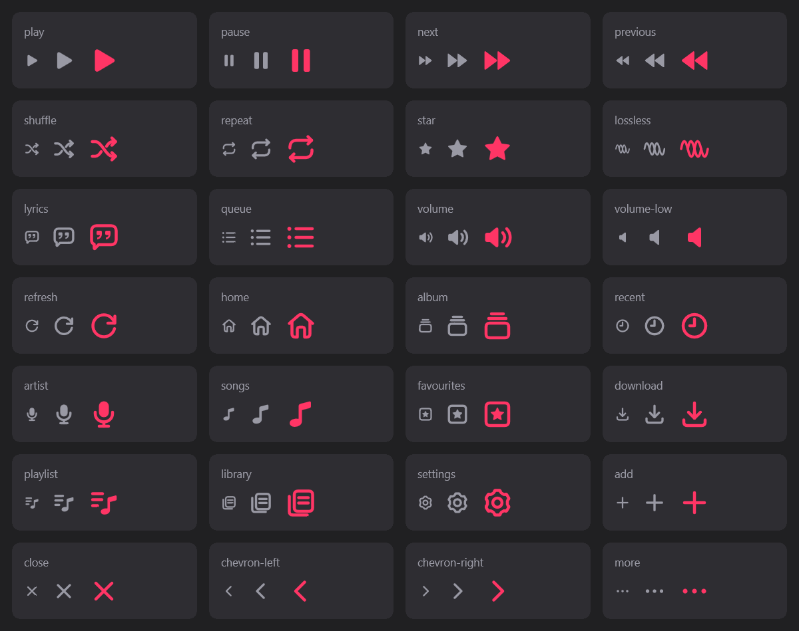

# AM Downloader 2.0.0-preview.5 · 桌面毛玻璃、播放标记与图标精修

本次更新修复顶部栏大面积无法拖动的问题，在歌曲列表中显示当前播放曲目，并将主窗口背景改为实时透出后方窗口和桌面的 Acrylic 毛玻璃。同时调整左右区域的不透明度、修复导航选中项的实心背景，并精修 17 个界面图标。

此版本为 **Pre-release（预览版）**；**1.5.2 继续作为稳定版**。

## 本次更新

### 桌面毛玻璃与界面层次

- 主窗口使用 Windows Desktop Acrylic，后方可见的其他窗口和桌面会模糊透出；移动窗口时，背景随实际后方内容变化。
- 主背景不再由专辑封面生成。左侧边栏与右侧内容区共用系统毛玻璃，深色覆盖层不透明度分别约为 **59%** 和 **78%**，使右侧文字与内容更清晰。这里的百分比指覆盖层，不是整个窗口的总不透明度。
- 导航选中项由实心灰底改为半透明高亮；正常、悬停和按下状态都能透出底层毛玻璃，保留圆角、文字清晰度和玫瑰红指示条。
- 左侧「资料库」分组的图标与标题对齐到「播放列表」。

毛玻璃外观遵循 Windows 的透明效果、节能和窗口激活状态；系统可能在相应条件下使用纯色回退。参见 [Microsoft Acrylic 材质说明](https://learn.microsoft.com/en-us/windows/apps/design/style/acrylic)。

### 顶部栏拖动

- 歌名、艺人文字、封面和顶部留白可用于拖动窗口。
- 拖动区域只避开实际按钮、搜索框和滑块；播放控制、音量、歌曲菜单、喜爱、歌词和队列入口仍可正常操作。
- 换歌导致标题宽度变化、展开／收起音量、调整窗口尺寸和切换全屏后，同步更新拖动范围。

### 当前播放歌曲标记

- 当前曲目在歌曲列表中显示**玫瑰红歌名和播放标记**；暂停后保留对应曲目，并显示暂停标记。
- 切歌时清除上一首的播放标记，并恢复原序号或收藏标记；停止并清空当前曲目后同步清除状态。
- 覆盖歌曲、最近添加、喜爱歌曲、搜索、专辑详情、自定义歌单及艺人歌曲列表；切页和滚动复用列表行后仍保持正确。
- 播放状态更新不改变用户已选中的行和多选状态，只在曲目或播放状态变化时刷新标记。

### 图标细节精修

沿用现有圆润风格，在 28 个矢量图标中精修 17 个：

- 统一上一首／下一首的双三角形比例和对称关系。
- 修正音量低端图标的居中，调整播放／暂停及循环箭头的比例。
- 拉开资料库叠层的间距，理顺歌词气泡和引号的曲线，收圆设置齿轮的折点。
- 统一歌曲与歌单中的音符比例，收拢「更多操作」三个圆点的间距。



## 下载与升级

需要 **Windows 10 2004（19041）或更新版本、x64**。安装版和便携版使用同一套运行文件，内含 .NET、Windows App SDK、音频引擎及下载后端。

| 附件 | 用途 | 大小 |
| --- | --- | --- |
| `AM-Downloader-2.0.0-preview.5-WinUI3-Windows-x64-Setup.exe` | 安装版，支持选择目录、快捷方式和卸载 | 392,556,858 字节，约 374 MiB |
| `AM-Downloader-2.0.0-preview.5-WinUI3-Windows-x64.zip` | 便携版，完整解压后运行 `AM Downloader WinUI.exe` | 463,870,783 字节，约 442 MiB |
| `manifest.sha256.json` | 运行目录逐文件 SHA-256 清单 | 与 ZIP 内清单相同 |
| `SHA256SUMS.txt` | 安装包、ZIP 与清单的 SHA-256 | 用于下载核对 |

升级前请在**系统托盘菜单选择「退出」**。安装版默认安装到 `%LOCALAPPDATA%\Programs\AM Downloader`，无需管理员权限；安装器尚未进行代码签名。便携版请完整解压到新目录，保留全部子目录，不要只复制 EXE。

继续使用 `%LOCALAPPDATA%\MusicDesk`，保留资料库路径、收藏、歌单、播放队列及同一 Windows 用户的账号设置。卸载保留个人资料库和原音乐文件；请避免新旧版本同时运行。

```text
eb55fb0654ff56ab4cda2932af3ab4e4b94b51963caf839692a4ea10aafb4bfb  AM-Downloader-2.0.0-preview.5-WinUI3-Windows-x64-Setup.exe
23986f23f4da5b35f689c3564d79dbe59120545f59163bf7f3627287244bfbdc  AM-Downloader-2.0.0-preview.5-WinUI3-Windows-x64.zip
```

## 验证范围

- 正式 ZIP 在仓库外独立运行，**4,420 个文件**完成完整性与包结构校验，**30 项原生集成检查通过**，覆盖 11 个页面。
- 新增检查覆盖两种窗口宽度下的顶部文字／封面拖动命中、按钮与音量滑块操作、分组标题对齐、播放／暂停／切歌标记、页面切换和列表行回收；导航高亮的正常、悬停和按下背景均为透明混合。
- 已通过真实桌面窗口操作验证歌名和封面区域拖动，以及后方独立窗口的模糊透出、移动时的背景变化、左右层次和选中高亮透色。XAML 静态截图本身不包含系统合成的 Acrylic 背景。
- 本次安装 EXE 在临时目录完成安装、同版本覆盖升级、全部文件校验、安装后独立 EXE 的 30 项检查和卸载；个人资料库配置保持不变。
- 本次没有修改音频解码引擎或下载后端源码，也没有新增真实 Apple 账号、DAC 独占输出及原生 DSD／DoP 的实机验收；既有能力和验证边界仍以对应版本说明为准。

完整功能与播放规格见 [项目 README](https://github.com/Lauk1z/AM-Downloader/tree/v2.0.0-preview.5#readme)，此前更新见 [preview.4](https://github.com/Lauk1z/AM-Downloader/releases/tag/v2.0.0-preview.4)。
